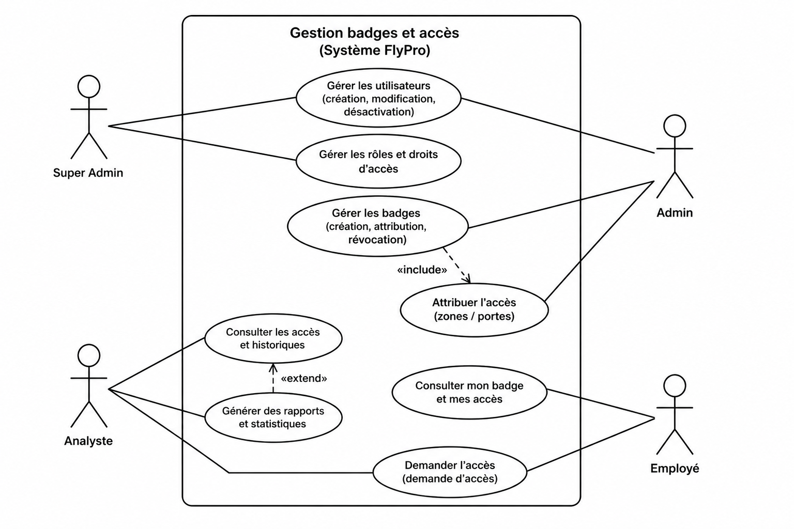
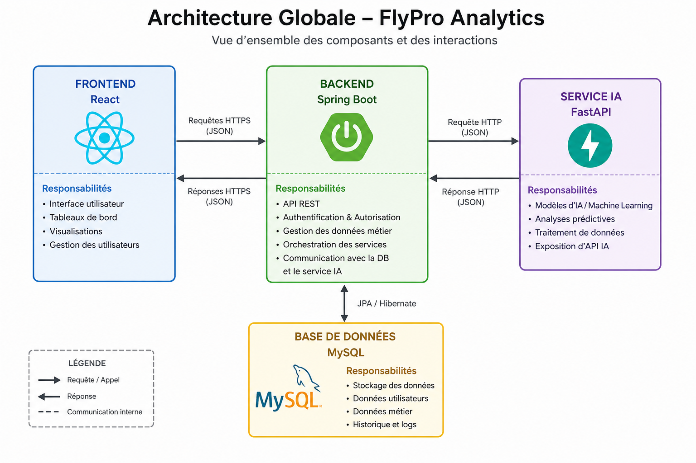
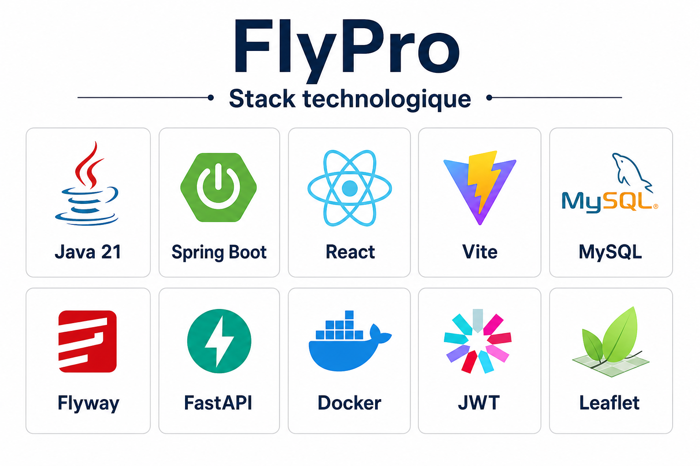
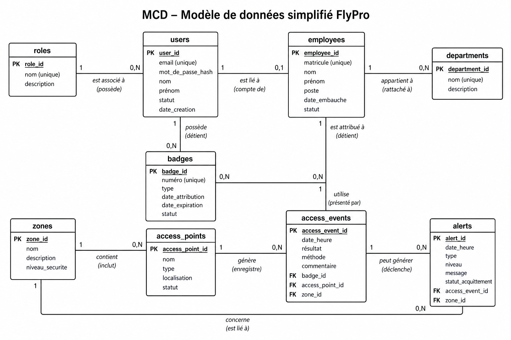
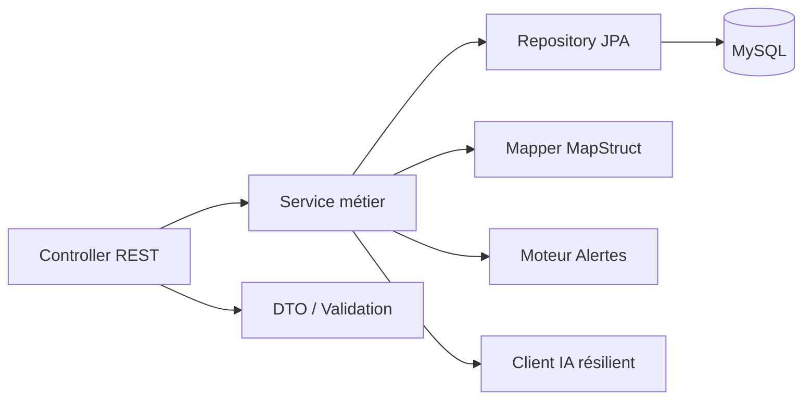
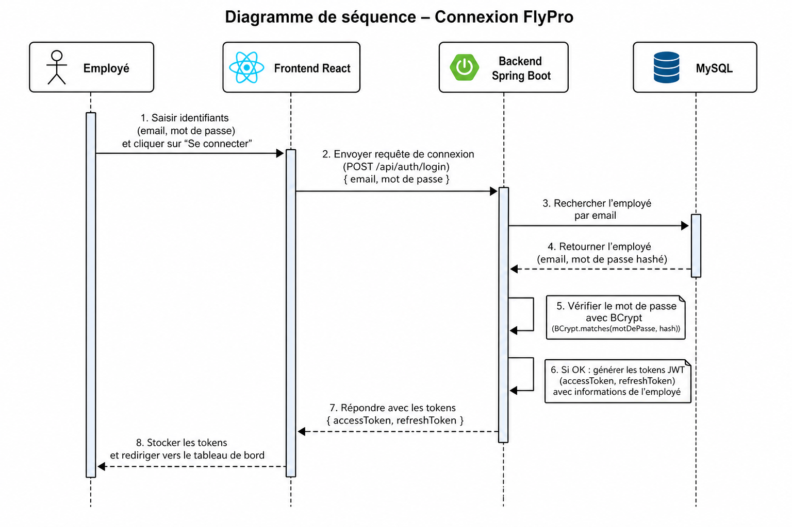

# Rapport de Stage / Projet de Fin d’Études

## FlyPro Analytics — Plateforme intelligente de gestion des badges et des accès

**Organisme d’accueil (contexte projet) :** Royal Air Maroc (cas d’usage siège Casa-Anfa)  
**Intitulé du projet :** FlyPro Analytics — Intelligent Badge & Access Management Platform  
**Période :** *[À compléter]*  
**Stagiaire / Étudiant(e) :** *[Nom Prénom]*  
**Encadrant académique :** *[À compléter]*  
**Encadrant professionnel :** *[À compléter]*  
**Établissement :** *[À compléter]*

---

## Remerciements

*[À personnaliser]*  
Je tiens à remercier mon encadrant académique, mon encadrant professionnel, ainsi que toutes les personnes qui ont contribué à la réussite de ce projet.

---

## Résumé

**FlyPro Analytics** est une plateforme web complète destinée à centraliser la **gestion des badges employés**, le **contrôle d’accès physique** (zones, points d’accès, profils horaires), le **journal des passages**, les **alertes de sécurité**, un **Digital Twin** du siège, et un module d’**intelligence artificielle** pour la détection d’anomalies.

La solution repose sur une architecture **multi-services** :

| Couche | Technologie principale | Rôle |
|--------|------------------------|------|
| Frontend | React 19 + Vite + TypeScript | Interface utilisateur (console admin + portail employé) |
| Backend | Spring Boot 3.5 + Java 21 | API REST, sécurité JWT, règles métier |
| Base de données | MySQL 8 + Flyway | Persistance versionnée |
| IA | FastAPI + Scikit-Learn | Isolation Forest + règles métier de risque |
| Déploiement | Docker / Docker Compose | Orchestration locale et packaging |

**Mots-clés :** badges, contrôle d’accès, Spring Boot, React, MySQL, JWT, RBAC, Digital Twin, Isolation Forest, PFE.

---

## Table des matières

1. [Introduction](#1-introduction)  
2. [Présentation du contexte et de la problématique](#2-présentation-du-contexte-et-de-la-problématique)  
3. [Objectifs du projet](#3-objectifs-du-projet)  
4. [Analyse des besoins](#4-analyse-des-besoins)  
5. [Architecture technique](#5-architecture-technique)  
6. [Stack technologique détaillée](#6-stack-technologique-détaillée)  
7. [Conception](#7-conception)  
8. [Réalisation fonctionnelle](#8-réalisation-fonctionnelle)  
9. [Sécurité et authentification](#9-sécurité-et-authentification)  
10. [Module Intelligence Artificielle](#10-module-intelligence-artificielle)  
11. [Déploiement et fonctionnement](#11-déploiement-et-fonctionnement)  
12. [Tests et validation](#12-tests-et-validation)  
13. [Bilan et perspectives](#13-bilan-et-perspectives)  
14. [Conclusion](#14-conclusion)  
15. [Annexes](#15-annexes)  
16. [Bibliographie / Webographie](#16-bibliographie--webographie)

---

## Liste des figures

| N° | Titre | Fichier |
|----|-------|---------|
| Figure 1 | Architecture globale FlyPro | `docs/figures/fig1-architecture-flypro.png` |
| Figure 2 | Diagramme de cas d’utilisation | `docs/figures/fig2-cas-utilisation-flypro.png` |
| Figure 3 | Modèle de données simplifié | `docs/figures/fig3-modele-donnees-flypro.png` |
| Figure 4 | Stack technologique | `docs/figures/fig4-stack-technologique-flypro.png` |
| Figure 5 | Séquence d’authentification JWT | `docs/figures/fig5-sequence-auth-flypro.png` |

## Liste des tableaux

| N° | Titre |
|----|-------|
| Tableau 1 | Services et ports |
| Tableau 2 | Stack frontend |
| Tableau 3 | Stack backend |
| Tableau 4 | Stack IA & infra |
| Tableau 5 | Rôles RBAC |
| Tableau 6 | Modules métier |
| Tableau 7 | Comptes de démonstration |
| Tableau 8 | Endpoints principaux |

---

# 1. Introduction

Dans les grandes organisations (compagnies aériennes, sites industriels, sièges sociaux), la **sûreté des accès** est un enjeu critique : il faut savoir **qui** peut entrer **où**, **quand**, et avec **quel badge**, tout en gardant une **traçabilité** complète et une capacité de **réaction** face aux anomalies.

Ce projet de fin d’études / stage vise à concevoir et réaliser **FlyPro Analytics**, une plateforme intelligente qui unifie :

- la gestion administrative des employés et des badges ;
- le paramétrage du contrôle d’accès ;
- le pilotage opérationnel (dashboard, alertes) ;
- la visualisation spatiale (Digital Twin) ;
- l’aide à la décision via l’IA.

Le présent rapport décrit le **contexte**, l’**analyse**, la **conception**, la **réalisation**, le **fonctionnement** et le **bilan** du projet.

---

# 2. Présentation du contexte et de la problématique

## 2.1 Contexte

Le cas d’usage retenu s’inspire du **siège Royal Air Maroc (Casa-Anfa)** : multiples bâtiments / zones, points d’accès, employés avec badges, besoin de supervision en temps quasi réel.

## 2.2 Problématique

Sans outil centralisé, les risques sont nombreux :

- badges expirés ou non révoqués encore utilisés ;
- droits d’accès incohérents selon les zones ;
- absence de journal unifié des passages ;
- détection tardive des comportements anormaux ;
- manque de visualisation opérationnelle pour les équipes sécurité / RH / IT.

**Question centrale :**  
*Comment concevoir une plateforme web sécurisée, scalable et intelligente pour gérer le cycle de vie des badges et contrôler les accès employés, avec supervision et détection d’anomalies ?*

## 2.3 Périmètre

| Inclus | Hors périmètre (évolutions) |
|--------|-----------------------------|
| CRUD métier badges / employés / zones | Lecteurs physiques RFID réels |
| API REST + UI web | Application mobile native |
| Alertes métier automatiques | Biométrie |
| Digital Twin plan 2D | Intégration SI RH legacy complète |
| IA Isolation Forest | Deep Learning avancé |

---

# 3. Objectifs du projet

## 3.1 Objectifs généraux

1. Centraliser la gestion des badges et des accès.  
2. Sécuriser l’application (JWT, RBAC, bonnes pratiques).  
3. Offrir un pilotage clair (dashboard, alertes, Digital Twin).  
4. Intégrer un module IA de détection d’anomalies.  
5. Livrer une solution **fonctionnelle** et **démontrable**.

## 3.2 Objectifs techniques

| Objectif | Indicateur de réussite |
|----------|------------------------|
| Backend modulaire (DDD léger) | Packages domaine + couches controller/service/repository |
| Frontend moderne | SPA React responsive, routes protégées |
| Persistance fiable | MySQL + migrations Flyway |
| Auth robuste | Login / refresh / logout JWT |
| Conteneurisation | Docker Compose opérationnel |

---

# 4. Analyse des besoins

## 4.1 Acteurs

| Acteur | Description |
|--------|-------------|
| **SUPER_ADMIN** | Administration complète (users, rôles, tout le métier) |
| **ADMIN** | Exploitation opérationnelle (CRUD, imports) |
| **ANALYST** | Consultation / analytics / dashboard (lecture) |
| **EMPLOYEE** | Portail personnel (badge, alertes, accès) |

### Figure 2 — Cas d’utilisation



*Figure 2 — Principaux cas d’utilisation selon les rôles.*

## 4.2 Besoins fonctionnels (extrait)

| ID | Besoin | Priorité |
|----|--------|----------|
| BF01 | Authentification sécurisée | Haute |
| BF02 | Gestion départements / employés | Haute |
| BF03 | Cycle de vie des badges | Haute |
| BF04 | Zones, points d’accès, profils | Haute |
| BF05 | Journal des événements d’accès | Haute |
| BF06 | Alertes automatiques | Haute |
| BF07 | Dashboard KPIs | Haute |
| BF08 | Digital Twin 2D | Moyenne |
| BF09 | Imports CSV/Excel | Moyenne |
| BF10 | Détection d’anomalies IA | Moyenne |
| BF11 | Portail employé | Moyenne |
| BF12 | Exports / reporting | Basse |

## 4.3 Besoins non fonctionnels

| Critère | Cible |
|---------|-------|
| Sécurité | JWT + RBAC + validation des entrées |
| Performance | APIs paginées, indexes MySQL |
| Maintenabilité | Architecture par domaine, migrations versionnées |
| Portabilité | Docker |
| Ergonomie | UI claire, branding cohérent |

---

# 5. Architecture technique

## 5.1 Vue d’ensemble

### Figure 1 — Architecture globale



*Figure 1 — Architecture multi-couches : Frontend ↔ Backend ↔ MySQL / Service IA.*

### Tableau 1 — Services et ports

| Service | Dossier | Port | Technologie |
|---------|---------|------|-------------|
| Frontend | `flypro-frontend` | 5173 (dev) | React + Vite |
| Backend API | `flypro-backend` | 8080 | Spring Boot |
| Base MySQL | local / Docker | 3306 | MySQL 8 |
| Service IA | `flypro-ai` | 8000 | FastAPI |
| Swagger UI | backend | `/swagger-ui.html` | SpringDoc |

## 5.2 Architecture logicielle backend

Organisation **modulaire par domaine** (approche DDD légère / Clean Architecture) :

```text
controller  →  service  →  repository / entity
     ↓              ↓
    dto          mapper / validator / specification / exception
```

Packages transverses : `config`, `security`, `common`, éventuellement `infra` (cache, client IA résilient).

## 5.3 Architecture frontend

Organisation **feature-based** :

```text
src/
  api/           → clients Axios
  features/      → pages métier (auth, dashboard, badges, …)
  components/    → UI réutilisable
  contexts/      → AuthContext
  routes/        → AppRouter + ProtectedRoute
  layouts/       → AppLayout, AuthLayout
```

## 5.4 Flux global de fonctionnement

```text
1. Admin paramètre Zones + Points + Profils
2. Admin crée Employé + Badge + affectation
3. Un passage génère un Access Event (AUTHORIZED / DENIED)
4. Le moteur d’alertes peut créer une Alerte
5. Dashboard / Digital Twin / IA consomment ces données
6. L’employé consulte son portail (/employee)
```

---

# 6. Stack technologique détaillée

### Figure 4 — Vue stack



*Figure 4 — Principales technologies utilisées dans FlyPro.*

> **Note pour le rapport Word/PDF :** pour chaque technologie, vous pouvez ajouter le logo officiel (téléchargé depuis le site éditeur) à côté du tableau. Les logos ne sont pas embarqués ici pour raisons de droits / marques.

## 6.1 Frontend — Tableau 2

| Technologie | Version (projet) | Rôle dans FlyPro | Comment ça fonctionne |
|-------------|------------------|------------------|------------------------|
| **React** | 19.x | Composants UI | Rendu déclaratif de pages (Dashboard, Badges…) |
| **TypeScript** | 6.x | Typage | Réduit les erreurs, contrats API typés |
| **Vite** | 8.x | Build / dev server | Hot Module Replacement rapide |
| **React Router** | 7.x | Navigation | Routes protégées selon rôle |
| **TanStack Query** | 5.x | Data fetching | Cache, refetch, états loading/error |
| **Axios** | 1.x | HTTP | Appels REST + intercepteur refresh JWT |
| **React Hook Form + Zod** | 7.x / 4.x | Formulaires | Validation côté client |
| **Tailwind CSS** | 4.x | Style | Design system rapide et responsive |
| **Recharts** | 3.x | Graphiques | KPIs dashboard |
| **Leaflet** | 1.9.x | Cartographie | Digital Twin plan 2D |
| **Framer Motion** | 12.x | Animations | Fluidité UI |
| **Vitest** | 4.x | Tests | Tests unitaires frontend |

## 6.2 Backend — Tableau 3

| Technologie | Version | Rôle | Comment ça fonctionne |
|-------------|---------|------|------------------------|
| **Java** | 21 | Langage serveur | Runtime JVM moderne |
| **Spring Boot** | 3.5.0 | Framework | Auto-config, REST, DI |
| **Spring Security** | (Boot) | Sécurité | Filtres, RBAC `@PreAuthorize` |
| **JJWT** | 0.12.6 | Tokens | Access + Refresh JWT HS256 |
| **Spring Data JPA** | (Boot) | ORM | Repositories, Specifications |
| **Hibernate** | (Boot) | Mapping objet-relationnel | Entités ↔ tables MySQL |
| **MySQL Connector/J** | runtime | Driver JDBC | Connexion à MySQL |
| **Flyway** | (Boot) + flyway-mysql | Migrations | Scripts `V1…Vn.sql` au démarrage |
| **MapStruct** | 1.6.3 | Mapping | Entity ↔ DTO |
| **Lombok** | optional | Productivité | Getters/builders réduits |
| **SpringDoc OpenAPI** | 2.8.5 | Documentation API | Swagger UI |
| **Caffeine** | (Boot cache) | Cache local | Accélération lectures |
| **Resilience4j** | 2.x | Résilience | Circuit breaker vers IA |
| **Apache POI / OpenCSV** | 5.x | Imports | Excel / CSV |
| **Maven** | 3.9+ | Build | Compilation & packaging |

## 6.3 IA & Infrastructure — Tableau 4

| Technologie | Version | Rôle | Comment ça fonctionne |
|-------------|---------|------|------------------------|
| **Python** | 3.12 | Langage IA | Runtime du microservice |
| **FastAPI** | 0.116.x | API IA | Endpoints predict / train |
| **Scikit-Learn** | 1.7.x | ML | Isolation Forest |
| **Pandas / NumPy** | 2.x | Data | Préparation features |
| **Joblib** | 1.5.x | Persistance modèle | Sauvegarde / chargement |
| **Uvicorn** | 0.35.x | Serveur ASGI | Exécution FastAPI |
| **Docker / Compose** | — | Conteneurs | Empaqueter et lancer la stack |
| **Nginx** | (prod) | Reverse proxy | Servir SPA + proxifier `/api` |
| **MySQL Workbench** | 8.x | Admin BDD | Inspection des tables |

---

# 7. Conception

## 7.1 Modèle de données

### Figure 3 — Schéma conceptuel simplifié



*Figure 3 — Principales entités et relations (vue simplifiée).*

### Entités clés

| Entité | Description |
|--------|-------------|
| `roles` / `users` | Authentification & RBAC |
| `departments` | Organisation |
| `employees` | Fiches employés (+ lien compte portail) |
| `badges` / `badge_assignments` | Cycle de vie badges |
| `zones` / `access_points` | Topologie d’accès |
| `access_profiles` (+ zones) | Droits horaires / spatiaux |
| `access_events` | Journal des passages |
| `alerts` | Alertes sécurité |
| `import_batches` / `data_quality_issues` | Imports |
| `anomaly_scores` | Scores IA |
| `audit_logs` | Traçabilité |

Les migrations Flyway (`V1` → `V14` selon version du dépôt) créent et font évoluer le schéma automatiquement au démarrage du backend.

## 7.2 Architecture des couches (backend)



## 7.3 Rôles — Tableau 5

| Rôle | Identifiant seed (exemple) | Droits typiques |
|------|----------------------------|-----------------|
| ROLE_SUPER_ADMIN | `admin` / `Admin@123` | Tout + users/roles |
| ROLE_ADMIN | `opsadmin` / `Admin@123` | Exploitation + imports |
| ROLE_ANALYST | `analyste` / `Admin@123` | Lecture + analytics |
| ROLE_EMPLOYEE | matricule / `Employee@123` | Portail `/employee` |

---

# 8. Réalisation fonctionnelle

## 8.1 Modules métier — Tableau 6

| Module UI | API principale | Fonctionnalités |
|-----------|----------------|-----------------|
| Connexion | `/api/v1/auth` | Login, refresh, logout, me |
| Dashboard | `/api/v1/dashboard/*` | KPIs, tendances, tops |
| Départements | `/api/v1/departments` | CRUD organisation |
| Employés | `/api/v1/employees` | CRUD + activation/archivage |
| Badges | `/api/v1/badges` | Création, assign, renew, suspend, revoke… |
| Zones | `/api/v1/zones` | Zones physiques |
| Profils d’accès | `/api/v1/access-profiles` | Horaires + zones autorisées |
| Points d’accès | `/api/v1/access-points` | Lecteurs / portes |
| Événements | `/api/v1/access-events` | Journal AUTHORIZED/DENIED |
| Alertes | `/api/v1/alerts` | Liste, ack, resolve, close |
| Imports | `/api/v1/imports` | Upload CSV/XLSX + qualité |
| Digital Twin | (zones + points + events) | Carte plan 2D live |
| Analytics IA | service `:8000` | Prédiction anomalies |
| Portail employé | `/api/v1/me/*` | Profil, badges, alertes |
| Settings / Users | `/api/v1/users` | Administration (SUPER_ADMIN) |

## 8.2 Parcours type « badge → accès → alerte »

1. Créer une **zone** et un **point d’accès**.  
2. Créer un **profil d’accès** (horaires + zones).  
3. Créer un **employé** (génère compte portail : matricule / `Employee@123`).  
4. Créer un **badge** et l’**assigner**.  
5. Enregistrer un **événement d’accès**.  
6. Observer **dashboard**, **Digital Twin** et éventuelle **alerte**.

## 8.3 Digital Twin

Le Digital Twin affiche un **plan schématique 2D** (Leaflet) du siège :

- polygones campus / terminaux ;
- marqueurs de zones et points d’accès ;
- pulses live lors des événements d’accès récents ;
- filtres par bâtiment / terminal.

## 8.4 Portail employé

Après connexion avec le **matricule** (identifiant) et le mot de passe temporaire, l’employé accède à :

- son profil ;
- ses badges ;
- ses alertes ;
- ses derniers accès.

---

# 9. Sécurité et authentification

### Figure 5 — Séquence de connexion



*Figure 5 — Flux Login → vérification → émission des tokens JWT.*

## 9.1 Principes

| Mécanisme | Détail |
|-----------|--------|
| Mot de passe | Hash **BCrypt** |
| Access Token | JWT courte durée |
| Refresh Token | JWT + persistance / révocation |
| Autorisation | RBAC (`ROLE_*`) |
| Protection login | Rate-limit / anti brute-force |
| Validation | Bean Validation + Zod côté UI |

## 9.2 Flux résumé

```text
POST /api/v1/auth/login
  → AuthenticationManager + BCrypt
  → génération Access JWT + Refresh JWT
  → frontend stocke les tokens
  → Authorization: Bearer <access>
  → en cas de 401 : POST /auth/refresh
  → logout : révocation refresh
```

### Tableau 7 — Comptes de démonstration

| Profil | Identifiant | Mot de passe |
|--------|-------------|--------------|
| Super Admin | `admin` | `Admin@123` |
| Employé | *matricule en minuscules* | `Employee@123` |

---

# 10. Module Intelligence Artificielle

## 10.1 Objectif

Détecter des **comportements d’accès anormaux** (horaires inhabituels, refus répétés, zones sensibles, etc.) pour assister les opérateurs.

## 10.2 Approche

| Élément | Choix |
|---------|-------|
| Algorithme | **Isolation Forest** (non supervisé) |
| Framework | Scikit-Learn |
| API | FastAPI (`/predict`, train/retrain…) |
| Complément | Moteur de **règles métier** (score de risque) |
| Intégration backend | Client HTTP résilient (circuit breaker) |

## 10.3 Décision typique

Une prédiction peut être classée **ANOMALY** si, par exemple :

- le modèle ML renvoie un label anormal, **ou**
- les règles métier dépassent un seuil de sévérité, **ou**
- le `risk_score` dépasse un seuil défini.

Les **alertes métier Java** et les **anomalies ML** sont complémentaires.

---

# 11. Déploiement et fonctionnement

## 11.1 Prérequis

- JDK 21 (ou compatible)  
- Maven 3.9+  
- Node.js 20+ / npm  
- MySQL 8 (service Windows ou Docker)  
- (Optionnel) Python 3.12 pour l’IA  
- MySQL Workbench pour l’administration visuelle  

## 11.2 Lancement local (Windows PowerShell)

### A. Base de données

Créer la base et l’utilisateur (Workbench / SQL) :

```sql
CREATE DATABASE IF NOT EXISTS flypro_analytics
  CHARACTER SET utf8mb4 COLLATE utf8mb4_unicode_ci;
CREATE USER IF NOT EXISTS 'flypro'@'localhost' IDENTIFIED BY 'flypro';
GRANT ALL PRIVILEGES ON flypro_analytics.* TO 'flypro'@'localhost';
FLUSH PRIVILEGES;
```

### B. Backend

```powershell
cd flypro-backend
$env:JAVA_HOME="C:\Users\<user>\.jdks\openjdk-25.0.2"   # adapter le chemin
$env:Path="$env:JAVA_HOME\bin;C:\Users\<user>\.maven\apache-maven-3.9.11\bin;$env:Path"
$env:DATABASE_URL="jdbc:mysql://localhost:3306/flypro_analytics?createDatabaseIfNotExist=true&useSSL=false&allowPublicKeyRetrieval=true&serverTimezone=UTC"
$env:DATABASE_USERNAME="flypro"
$env:DATABASE_PASSWORD="flypro"
$env:JWT_SECRET="dev-only-change-me-not-for-production"
$env:SPRING_PROFILES_ACTIVE="dev"
mvn spring-boot:run
```

→ Flyway crée les tables automatiquement.  
→ Swagger : http://localhost:8080/swagger-ui.html

### C. Frontend

```powershell
cd flypro-frontend
npm install
npm run dev
```

→ Application : http://localhost:5173/

### D. (Optionnel) Service IA

```powershell
cd flypro-ai
python -m venv .venv
.\.venv\Scripts\Activate.ps1
pip install -r requirements.txt
uvicorn app.main:app --reload --port 8000
```

## 11.3 Vérification que « ça fonctionne »

| Contrôle | Attendu |
|----------|---------|
| MySQL service | `MySQL80` = Running |
| Port 3306 | Ouvert |
| Backend | http://localhost:8080/swagger-ui.html → HTTP 200 |
| Frontend | http://localhost:5173/ → page de login |
| Login admin | Accès dashboard |
| Tables MySQL | `users`, `roles`, `employees`, `badges`, … visibles dans Workbench |

---

# 12. Tests et validation

| Type | Outil | Exemples |
|------|-------|----------|
| Tests unitaires / intégration backend | JUnit + Spring Boot Test + H2 | Auth, repositories, services |
| Tests frontend | Vitest + Testing Library | Composants / logique UI |
| Tests manuels | Navigateur + Swagger | Parcours métiers |
| Validation API | SpringDoc | Contrats REST |

Scénarios de validation manuelle recommandés :

1. Login admin → dashboard.  
2. Création employé → compte portail.  
3. Création / assignation badge.  
4. Création événement d’accès.  
5. Apparition pulse Digital Twin.  
6. Login employé avec matricule.  

---

# 13. Bilan et perspectives

## 13.1 Apports du stage / PFE

- Maîtrise d’une stack **full-stack moderne** (React + Spring Boot + MySQL).  
- Mise en pratique de la **sécurité applicative** (JWT, RBAC).  
- Conception **modulaire** et migrations **Flyway**.  
- Intégration d’un service **IA** complémentaire.  
- Livraison d’un produit **démontrable** de bout en bout.

## 13.2 Difficultés rencontrées

| Difficulté | Solution |
|------------|----------|
| Passage PostgreSQL → MySQL | Adaptation Docker, driver, migrations SQL |
| Compte BDD / droits | Script d’init + Workbench |
| Environnement Windows (PATH Java/Maven) | Variables `JAVA_HOME` / PATH explicites |
| Complexité Digital Twin 3D | Simplification vers vue 2D Leaflet |

## 13.3 Perspectives

- Connexion à des lecteurs d’accès réels (MQTT / webhooks).  
- Notifications push / e-mail avancées.  
- Amélioration continue du modèle IA (retrain périodique).  
- Déploiement Kubernetes HA (Redis, RabbitMQ).  
- Application mobile employé.

---

# 14. Conclusion

FlyPro Analytics répond à un besoin concret de **centralisation** et de **sécurisation** de la gestion des badges et des accès. L’architecture multi-services (React, Spring Boot, MySQL, FastAPI) permet une séparation claire des responsabilités, une évolution progressive, et une démonstration opérationnelle complète : de la création d’un employé jusqu’à la supervision live et l’analyse d’anomalies.

Le projet constitue ainsi une base solide pour un déploiement pilote en environnement d’entreprise, tout en offrant un terrain riche d’apprentissage en ingénierie logicielle et data/IA.

---

# 15. Annexes

## Annexe A — Structure des dépôts livrables

```text
pfe Ram/
├── flypro-backend/     # API Spring Boot
├── flypro-frontend/    # SPA React
├── flypro-ai/          # Microservice IA
├── docs/               # Documentation + ce rapport
│   ├── figures/        # Figures du rapport
│   └── RAPPORT_DE_STAGE_FLYPRO.md
└── docker-compose.yml  # (si présent à la racine)
```

## Annexe B — Endpoints principaux (Tableau 8)

| Méthode | Endpoint | Description |
|---------|----------|-------------|
| POST | `/api/v1/auth/login` | Connexion |
| POST | `/api/v1/auth/refresh` | Rafraîchir token |
| GET | `/api/v1/auth/me` | Profil courant |
| GET/POST | `/api/v1/employees` | Employés |
| GET/POST | `/api/v1/badges` | Badges |
| GET/POST | `/api/v1/zones` | Zones |
| GET/POST | `/api/v1/access-events` | Événements |
| GET | `/api/v1/dashboard/...` | KPIs |
| GET | `/api/v1/me/...` | Portail employé |

## Annexe C — Captures d’écran à ajouter (recommandé)

Pour finaliser le rapport Word/PDF, ajoutez vos propres captures :

1. Page de **Login**  
2. **Dashboard** admin  
3. Liste **Employés** / **Badges**  
4. **Digital Twin** 2D  
5. **Swagger UI**  
6. **MySQL Workbench** (tables `flypro_analytics`)  
7. Portail **Employé**  

Placez-les dans `docs/figures/` sous les noms `capture-01-login.png`, etc., puis référencez-les dans le document final.

## Annexe D — Glossaire

| Terme | Définition |
|-------|------------|
| Badge | Identifiant physique/logique d’accès |
| Zone | Espace physique contrôlé |
| Access Point | Point de contrôle (porte, tourniquet…) |
| Access Event | Enregistrement d’un passage |
| JWT | JSON Web Token |
| RBAC | Contrôle d’accès basé sur les rôles |
| Flyway | Outil de migrations SQL versionnées |
| Isolation Forest | Algorithme de détection d’anomalies |

---

# 16. Bibliographie / Webographie

1. Documentation Spring Boot — https://spring.io/projects/spring-boot  
2. Documentation React — https://react.dev  
3. Documentation Vite — https://vitejs.dev  
4. Documentation MySQL 8 — https://dev.mysql.com/doc/  
5. Documentation Flyway — https://documentation.red-gate.com/flyway  
6. Documentation FastAPI — https://fastapi.tiangolo.com  
7. Scikit-Learn IsolationForest — https://scikit-learn.org  
8. Leaflet — https://leafletjs.com  
9. OWASP Authentication Cheat Sheet — https://owasp.org  

---

## Page de fin

**FlyPro Analytics** — Rapport de stage / PFE  
*[Nom Prénom] — [Année universitaire]*  
Document généré à partir du dépôt projet — à personnaliser (noms, période, captures, logos établissement / entreprise).
